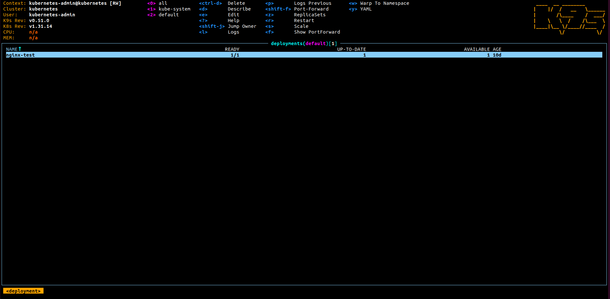

# Description
DoC k9s kubernetes TUI management

## Steps

- **STEP01**: Install k9s in Linux

```shell
$ curl -sL https://github.com/derailed/popeye/releases/latest/download/popeye_linux_amd64.tar.gz | tar -xz popeye
$ sudo mv popeye /usr/local/bin/
```

- **STEP02**: Execute k9s

k9s will use the current context configured in your default .kube/config to connect to a kubernetes cluster
```shell
$ k9s
```




## Links

- [k9s Portal](https://k9scli.io/)
